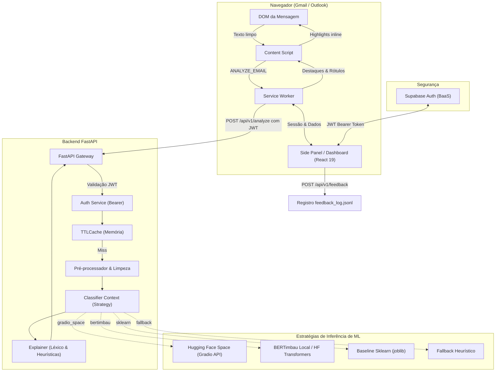
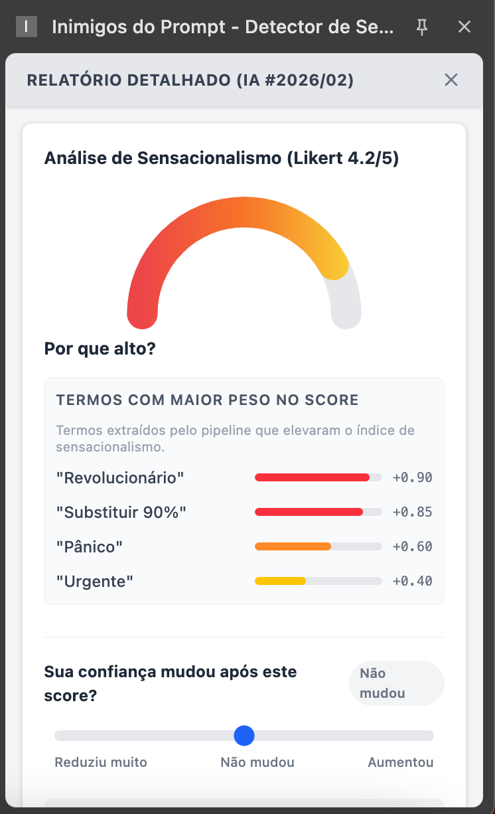
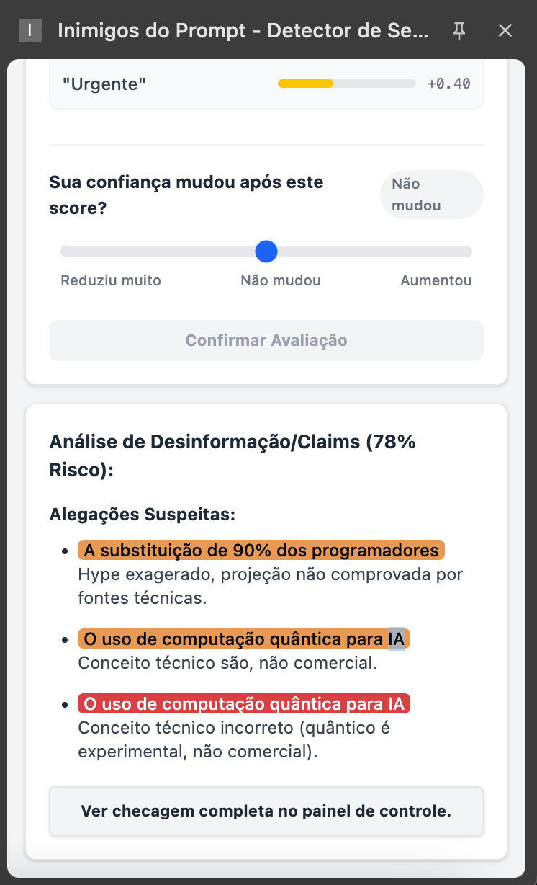
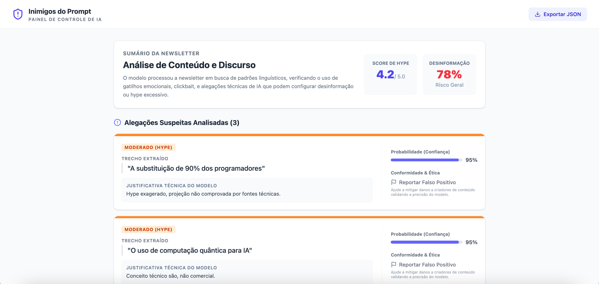

<p align="center">
  
</p>

# Challenge 1 — Inimigos do Prompt

Projeto da disciplina **Sistemas de Machine Learning (2026/02)**. A proposta é ajudar leitores de newsletters de tecnologia em português a identificarem sinais de sensacionalismo (*hype*) e alegações que merecem leitura crítica diretamente no navegador.

O repositório contém uma prova de conceito composta por pipeline de dados/ML, API FastAPI modular com padrão Strategy e extensão para navegadores (Chrome e Firefox). A documentação completa está publicada em [unb-Sistemas-de-Machine-learning.github.io/challenge_1_inimigos_do_prompt](https://unb-sistemas-de-machine-learning.github.io/challenge_1_inimigos_do_prompt/).

---

## Visão Geral da Solução



---

## Estado atual da PoC

- **Extensão Multi-Navegador:** Injetada no Gmail e Outlook Live via Manifest V3 para Google Chrome e Mozilla Firefox. Extrai texto e renderiza grifos de termos enfáticos.
- **Autenticação Segura:** Integrada com Supabase Auth via tokens JWT enviados no header `Authorization: Bearer`.
- **API FastAPI com Strategy Pattern:** Suporta múltiplos backends de inferência (`gradio_space`, `bertimbau`, `sklearn` e `huggingface_api`). Retorna score de 1 a 5, termos destacados, claims de tom enfático e risco heurístico de desinformação.
- **Painel Lateral & Dashboard:** Interface em React 19 com Tailwind CSS, monitoramento do estado da API, envio de feedback e exportação de relatórios.
- **Pipeline de Dados & Treinamento:** Scripts para extração e processamento do *Fake.br-Corpus*, *FactChecks.br* e scrapers, além de notebooks para baseline TF-IDF e fine-tuning do BERTimbau ([gustant1/bertimbau-sensacionalismo](https://huggingface.co/gustant1/bertimbau-sensacionalismo)).

---

## Componentes

| Diretório | Finalidade |
| --- | --- |
| `src/` | Coleta, preparação de dados, scrapers e scripts de treinamento. |
| `backend/` | API FastAPI, autenticação Supabase, estratégias de ML, cache e feedback. |
| `extension/` | Extensão Chrome e Firefox (React 19, TypeScript, Vite, Tailwind CSS). |
| `website/` | Portal de documentação interativo construído com Astro Starlight. |

---

## Execução Rápida

### 1. Iniciar o Backend

```bash
cd backend
python3 -m venv .venv
source .venv/bin/activate  # No Windows: .venv\Scripts\activate
pip install -r requirements-api.txt

# Copie e preencha as variáveis de ambiente
cp .env.example .env

# Inicie o servidor
uvicorn app.main:app --reload --host 0.0.0.0 --port 8000
```

> [!TIP]
> Por padrão, o backend utiliza a estratégia `MODEL_BACKEND=gradio_space` ou `MODEL_BACKEND=sklearn`, não exigindo o download pesado de PyTorch/Transformers no primeiro contato. Configure seu `SUPABASE_JWT_SECRET` no `.env` para autenticação.

### 2. Compilar e Carregar a Extensão

```bash
cd extension
npm install

# Para Google Chrome:
npm run build:chrome   # gera extension/dist-chrome/

# Para Mozilla Firefox:
npm run build:firefox  # gera extension/dist-firefox/
```

- **No Google Chrome:** Acesse `chrome://extensions/`, ative o *Modo do desenvolvedor* e clique em **Carregar sem compactação**, selecionando a pasta `extension/dist-chrome`.
- **No Mozilla Firefox:** Acesse `about:debugging#/runtime/this-firefox`, clique em **Carregar extensão temporária** e selecione o arquivo `extension/dist-firefox/manifest.json`.

### 3. Iniciar o Portal de Documentação

```bash
cd website
npm install
npm run dev
```

Consulte a documentação completa em [unb-Sistemas-de-Machine-learning.github.io/challenge_1_inimigos_do_prompt](https://unb-sistemas-de-machine-learning.github.io/challenge_1_inimigos_do_prompt/).

---

## Telas da Aplicação

<p align="center">
  
  
</p>

<p align="center">
  
</p>
