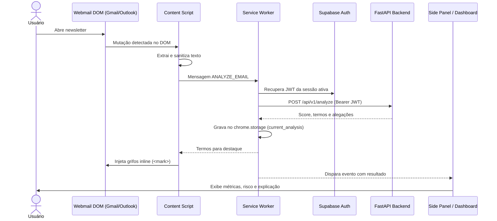

# Extensão Web — Inimigos do Prompt

Extensão para navegadores baseada em Manifest V3 desenvolvida com React 19, TypeScript, Vite e Tailwind CSS. Observa newsletters abertas no Gmail e Outlook Live, extrai o conteúdo textual e consulta a API FastAPI para destacar trechos sensacionalistas e exibir a análise no painel lateral.

---

## Fluxo de Execução da Extensão



---

## Desenvolvimento e Compilação

Instale as dependências:

```bash
npm install
```

Crie o arquivo de configuração local a partir do modelo:

```bash
cp .env.example .env
```

Preencha as credenciais do seu projeto Supabase no `.env` (`VITE_SUPABASE_URL` e `VITE_SUPABASE_ANON_KEY`). Opcionalmente, defina `VITE_API_URL` se o backend não estiver rodando no padrão `http://localhost:8000`.

### Modo Desenvolvimento (Vite)

```bash
npm run dev
```

### Compilação de Produção

- **Para Google Chrome:**
  ```bash
  npm run build:chrome
  ```
  Os arquivos compilados são gerados em `extension/dist-chrome/`. Acesse `chrome://extensions`, ative o **Modo do desenvolvedor** e clique em **Carregar sem compactação**, selecionando `extension/dist-chrome`.

- **Para Mozilla Firefox:**
  ```bash
  npm run build:firefox
  ```
  Os arquivos compilados são gerados em `extension/dist-firefox/`. Acesse `about:debugging#/runtime/this-firefox`, clique em **Carregar extensão temporária** e aponte para `extension/dist-firefox/manifest.json`.

---

## Comunicação com o Backend

A extensão envia as requisições autenticadas para:
* `POST /api/v1/analyze`: Análise textual de newsletters.
* `POST /api/v1/feedback`: Envio de ajustes no slider de sensibilidade ou reporte de falsos positivos.
* `GET /health`: Monitoramento de conectividade com a API.

Todas as chamadas para rotas protegidas injetam automaticamente o token JWT retornado pelo Supabase no cabeçalho `Authorization: Bearer <token>`.
