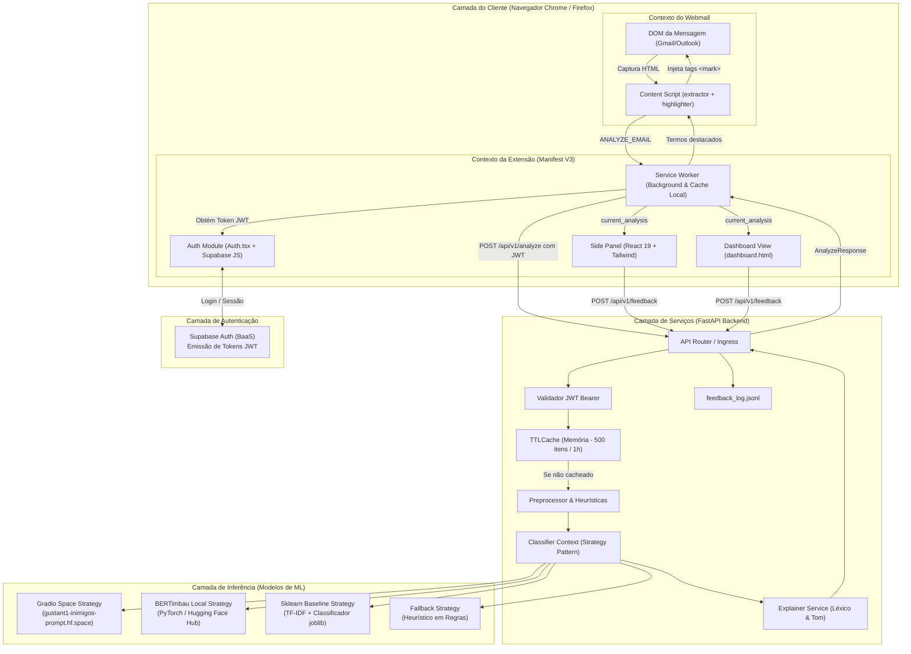
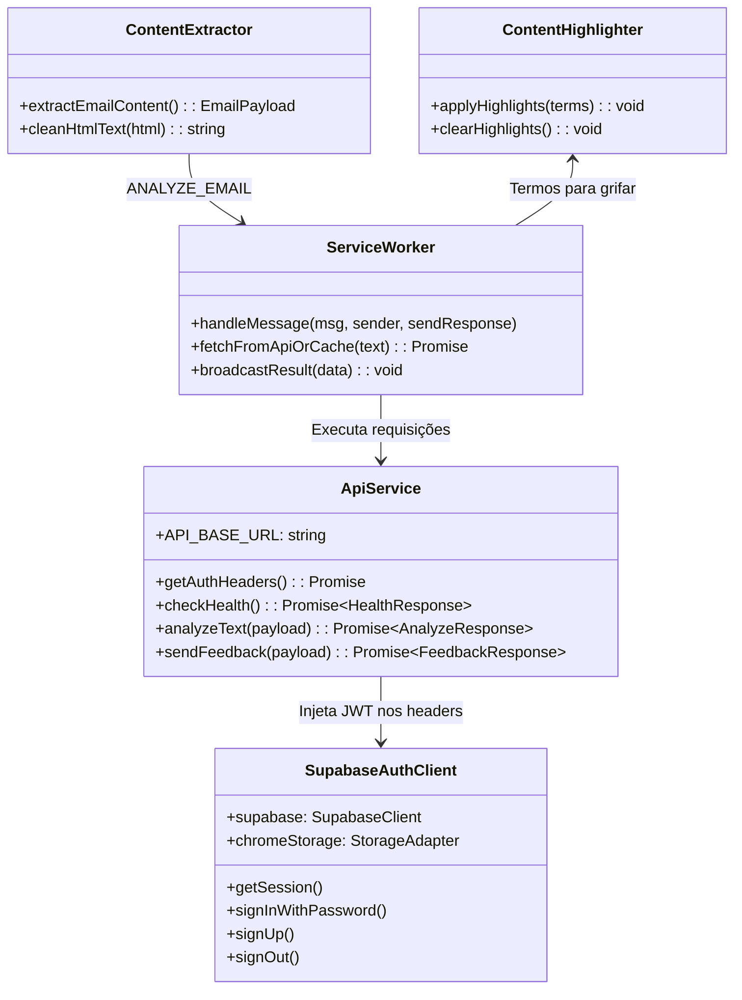

Esta página descreve a arquitetura implementada na Prova de Conceito (PoC), cobrindo o fluxo entre a extensão do navegador, o provedor de autenticação e o backend FastAPI com estratégias dinâmicas de Machine Learning.

---

## Visão Geral da Arquitetura do Sistema



---

## Fluxo de Execução da PoC

```mermaid
sequenceDiagram
    actor User as Usuário
    participant DOM as Webmail DOM
    participant CS as Content Script
    participant SW as Service Worker
    participant Auth as Supabase Auth
    participant API as FastAPI Backend
    participant SP as Side Panel

    User->>DOM: Abre mensagem no Gmail ou Outlook Live
    DOM->>CS: Mutação no DOM detectada
    CS->>CS: Extrai e sanitiza texto
    CS->>SW: Mensagem ANALYZE_EMAIL
    SW->>SW: Verifica cache em chrome.storage.local
    alt Se não estiver em cache
        SW->>Auth: Recupera access_token da sessão ativa
        SW->>API: POST /api/v1/analyze (Header Bearer JWT)
        API->>API: Valida token, executa Strategy ML e Explainer
        API-->>SW: Retorna Score, Termos e Alegações
        SW->>SW: Salva em cache e current_analysis
    end
    SW-->>CS: ANALYSIS_RESULT
    CS->>DOM: Destaca termos no corpo da mensagem (&lt;mark&gt;)
    SW-->>SP: Broadcast do resultado da análise
    SP->>User: Exibe Score, Nível de Risco e Alegações
```

---

## Componentes Existentes

| Camada | Implementação Atual |
| --- | --- |
| **Manifesto** | Manifest V3 com compatibilidade dual para **Chrome** (`side_panel`) e **Firefox** (`sidebar_action`), permissões de `storage`, `activeTab`, `tabs` e hosts para `localhost` e `inimigos-do-prompt-api.onrender.com`. |
| **Content script** | `src/content/`: extrai texto visível do Gmail (`.a3s.aiL`) e Outlook (`.x_WordSection1`), e aplica grifos nos termos relevantes. |
| **Service worker** | `src/background/service-worker.ts`: gerencia cache local, despacha requisições à API com autenticação e sincroniza o estado via `current_analysis`. |
| **Interface Frontend** | React 19, TypeScript, Vite, Tailwind CSS e Lucide Icons. Telas de autenticação (`Auth.tsx`), painel lateral (`App.tsx`) e dashboard completo (`Dashboard.tsx`). |
| **Autenticação** | Cliente `@supabase/supabase-js` com adaptador de armazenamento customizado para `chrome.storage.local`. |
| **Backend API** | FastAPI com injeção de dependência para verificação de JWT, padrão Strategy para seleção de modelo ML, cache em memória (`TTLCache`) e logging de feedback em JSONL. |

---

## Diagrama de Classes e Componentes da Extensão



---

## Estrutura Efetiva do Código

```text
extension/
├── manifest.json
├── index.html                 # Side panel
├── dashboard.html             # Dashboard em aba completa
├── vite.config.ts             # Configuração Vite multi-browser (Chrome & Firefox)
└── src/
    ├── App.tsx                # Interface principal do Side Panel
    ├── Auth.tsx               # Componente de Login e Cadastro (Supabase)
    ├── lib/
    │   └── supabase.ts        # Inicialização do Supabase com chrome.storage
    ├── background/
    │   └── service-worker.ts  # Background worker, listeners e cache
    ├── content/
    │   ├── extractor.ts       # Seletores DOM Gmail/Outlook e sanitização
    │   ├── highlighter.ts     # Injeção de grifos inline
    │   └── index.ts           # Ponto de entrada do Content Script
    ├── dashboard/
    │   ├── Dashboard.tsx      # Dashboard analítico detalhado
    │   └── main.tsx
    ├── services/
    │   └── api.ts             # Cliente HTTP com injeção de Bearer Token
    └── types/
        └── index.ts           # Interfaces TypeScript da aplicação
```
