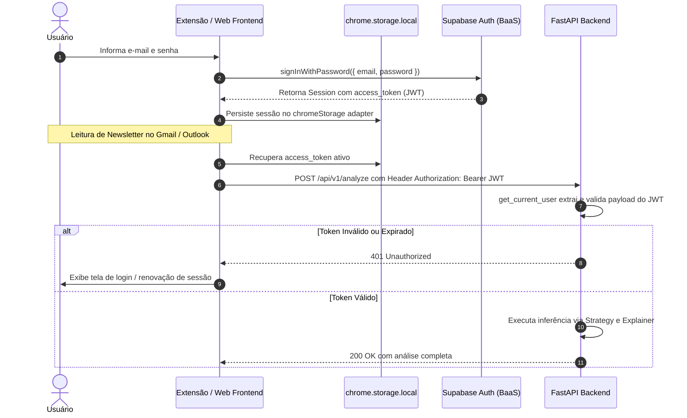
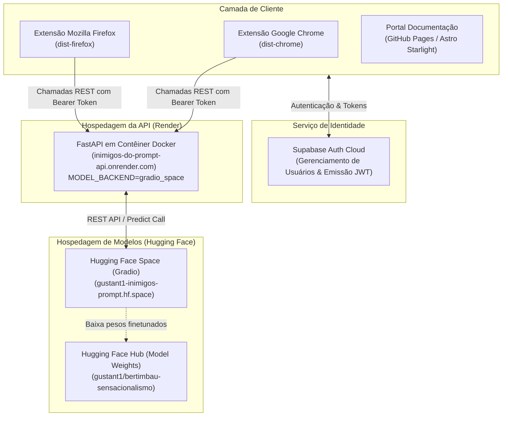

Esta documentação detalha a arquitetura de segurança, o fluxo de tokens JWT com o Supabase, a refatoração do motor de inferência via padrão Strategy e a topologia de deploy em nuvem.

---

## Fluxo Completo de Autenticação e Sessão (Supabase)

---

## Topologia de Deploy e Integração em Nuvem

---

## Fase 1: Provedor de Autenticação (Supabase)

Adotou-se o **Supabase** como Backend-as-a-Service (BaaS) para autenticação, eliminando o risco e a complexidade de armazenamento manual de senhas e hashing criptográfico:

- **Controle de Acesso:** Usuários realizam cadastro e login utilizando e-mail e senha.
- **Tokens Padronizados:** Emissão de tokens JWT assinados via algoritmo HMAC-SHA256 contendo informações de usuário (`sub`, `email`, `exp`).

---

## Fase 2: Integração com o Frontend (Extensão Web)

No contexto de extensões Manifest V3, o `localStorage` tradicional pode não estar disponível em todos os contextos de execução (ex: Service Workers isolados). 

Para contornar essa restrição, foi desenvolvido um adaptador customizado (`chromeStorage`) em `extension/src/lib/supabase.ts`, implementando a interface `SupportedStorage` da biblioteca `@supabase/supabase-js` através das APIs nativas `chrome.storage.local`.

---

## Fase 3: Proteção de Rotas no FastAPI

O backend valida as requisições através do módulo `app/services/auth.py`, utilizando a injeção de dependência `Depends(get_current_user)` do FastAPI:

1. O cabeçalho `Authorization: Bearer <token>` é extraído pela classe `HTTPBearer`.
2. A aplicação verifica a presença de `SUPABASE_JWT_SECRET` nas configurações.
3. Decodifica o payload e confere o tempo de expiração (`exp`), rejeitando requisições inválidas ou expiradas com status `401 Unauthorized`.

---

## Fase 4: Padrão Strategy na Inferência

Para desacoplar a camada de API dos modelos de Machine Learning, implementou-se o padrão **Strategy**:

- **Interface Abstrata (`ModelStrategy`):** Exige a implementação do método `predict(text: str, features: dict) -> Tuple[str, float]`.
- **Implementações Intercambiáveis:**
  * `GradioSpaceStrategy`: Delega o processamento pesado de linguagem natural para o Hugging Face Space.
  * `BertimbauLocalStrategy`: Executa BERTimbau localmente via PyTorch / Transformers.
  * `SklearnStrategy`: Executa o classificador baseline scikit-learn.
  * `FallbackStrategy`: Heurística baseada em regras léxicas em caso de indisponibilidade de rede.

---

## Fase 5: Topologia de Produção no Render e Hugging Face

Para disponibilizar a solução sem custos de infraestrutura e contornar os limites de memória RAM dos planos gratuitos:

1. **Backend no Render:** O repositório possui o arquivo [`render.yaml`](file:///e:/challenge_1_inimigos_do_prompt/render.yaml), que provisiona um contêiner Docker leve rodando a API FastAPI com `MODEL_BACKEND="gradio_space"`.
2. **Inferência no Hugging Face:** O modelo BERTimbau ajustado finamente executa em um Space dedicado com Gradio, expondo o endpoint `/predict` consumido pelo backend.
