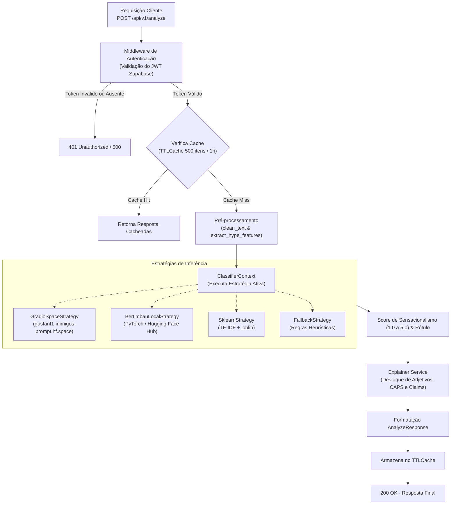
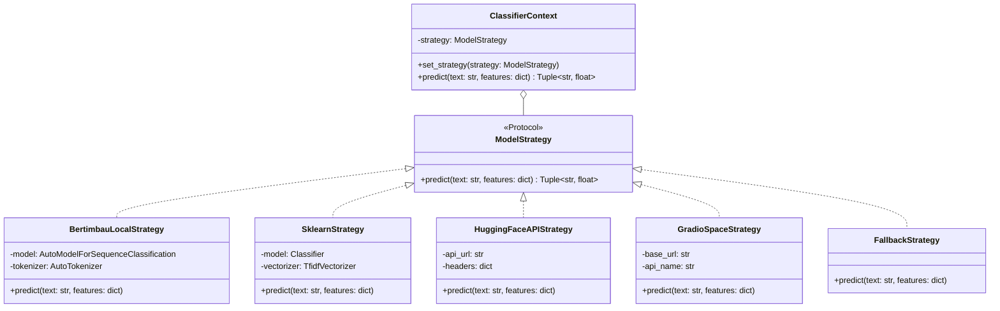

O backend é uma API em FastAPI responsável pelo processamento de linguagem natural, análise de sensacionalismo (*hype*) e explicabilidade das newsletters. Ele adota uma arquitetura modular com o padrão de projeto **Strategy**, permitindo alternar de forma transparente entre inferência local, modelos em nuvem ou fallbacks heurísticos.

---

## Ciclo de Vida da Requisição (`/analyze`)



---

## Padrão Strategy para Inferência de ML

A camada de classificação desacopla a rota da tecnologia de machine learning utilizada através do padrão Strategy:



### Backends Suportados

A estratégia ativa é definida pela variável de ambiente `MODEL_BACKEND`:

1. **`gradio_space` (Padrão em Produção / Render):**
   * Conecta-se via REST ao Space Hugging Face em [`gustant1-inimigos-prompt.hf.space`](https://gustant1-inimigos-prompt.hf.space).
   * Vantagem: Permite rodar o backend em contêineres leves (Render Free Tier) sem alocar 2GB+ de memória RAM para carregar PyTorch e pesos de transformers.

2. **`bertimbau` (Inferência Local / Hub):**
   * Utiliza a biblioteca `transformers` para carregar o modelo fine-tuned `neuralmind/bert-base-portuguese-cased` ([gustant1/bertimbau-sensacionalismo](https://huggingface.co/gustant1/bertimbau-sensacionalismo)).
   * Requer instalação prévia de `pip install transformers torch`.

3. **`sklearn` (Baseline Local):**
   * Carrega os artefatos `backend/app/ml/artifacts/model.joblib` e `vectorizer.joblib`.
   * Realiza inferência vetorial com TF-IDF e regressão logística.

4. **`huggingface_api`:**
   * Utiliza a Inference API oficial do Hugging Face via chamadas HTTP com token de autenticação.

5. **`fallback`:**
   * Utilizado automaticamente caso os modelos ou dependências não estejam acessíveis, aplicando heurísticas léxicas defensivas.

---

## Rotas da API

### `GET /health`

Retorna o status da aplicação, se os modelos estão carregados e qual a estratégia ativa:

```bash
curl http://localhost:8000/health
```

```json
{
  "status": "healthy",
  "model_loaded": true,
  "model_backend": "gradio_space"
}
```

---

### `POST /api/v1/analyze` *(Protegida por Autenticação)*

Analisa o texto de uma newsletter, gerando score de sensacionalismo, termos de destaque, alegações enfáticas e risco heurístico de desinformação.

**Cabeçalhos:**
* `Content-Type: application/json`
* `Authorization: Bearer <token_jwt_supabase>`

**Corpo da Requisição (Input):**
```json
{
  "email_id": "opcional-uuid",
  "sender": "newsletter@exemplo.com",
  "subject": "IA vai DESTRUIR todos os empregos?",
  "raw_text": "URGENTE! Uma nova inteligência artificial revolucionária promete substituir 90% dos profissionais até o final do ano."
}
```

**Resposta (Output):**
```json
{
  "email_id": "c1f72836-e093-4a17-b769-cf368d18e2be",
  "sensationalism_score": 4.2,
  "label": "Hype Elevado",
  "confidence": 0.85,
  "highlighted_terms": [
    {
      "term": "Urgente",
      "weight": 0.6,
      "category": "alarmist"
    },
    {
      "term": "Revolucionária",
      "weight": 0.6,
      "category": "alarmist"
    },
    {
      "term": "DESTRUIR",
      "weight": 0.4,
      "category": "hype"
    }
  ],
  "disclaimer": "Mede o tom da linguagem (sensacionalismo), não a veracidade do conteúdo. Os padrões listados são heurísticas de apoio ao modelo.",
  "disinformation_risk": 84,
  "suspicious_claims": [
    {
      "claim": "URGENTE! Uma nova inteligência artificial revolucionária promete substituir 90% dos profissionais até o final do ano.",
      "explanation": "Linguagem enfática (adjetivos extremos: 'urgente', 'revolucionária'; palavras em CAPS: 'DESTRUIR'; exclamação).",
      "severity": "high"
    }
  ]
}
```

---

### `POST /api/v1/feedback` *(Protegida por Autenticação)*

Recebe avaliações de confiança do usuário (via slider) ou reporte de falsos positivos, persistindo em `backend/feedback_log.jsonl`.

**Cabeçalhos:**
* `Content-Type: application/json`
* `Authorization: Bearer <token_jwt_supabase>`

**Corpo da Requisição:**
```json
{
  "email_id": "c1f72836-e093-4a17-b769-cf368d18e2be",
  "feedback_type": "false_positive",
  "claim_index": 0,
  "comment": "O texto apenas cita um estudo acadêmico, não se trata de sensacionalismo."
}
```

---

## Configuração do Ambiente (`.env`)

Crie o arquivo `backend/.env` baseado no exemplo `backend/.env.example`:

```ini
MODEL_BACKEND=gradio_space
GRADIO_SPACE_URL=https://gustant1-inimigos-prompt.hf.space
SUPABASE_JWT_SECRET=seu_jwt_secret_aqui
```

---

## Execução

### Ambiente Virtual Local
```bash
cd backend
python3 -m venv .venv
source .venv/bin/activate  # Windows: .venv\Scripts\activate
pip install -r requirements-api.txt
uvicorn app.main:app --reload --host 0.0.0.0 --port 8000
```

### Docker
```bash
cd backend
docker compose up --build
```
