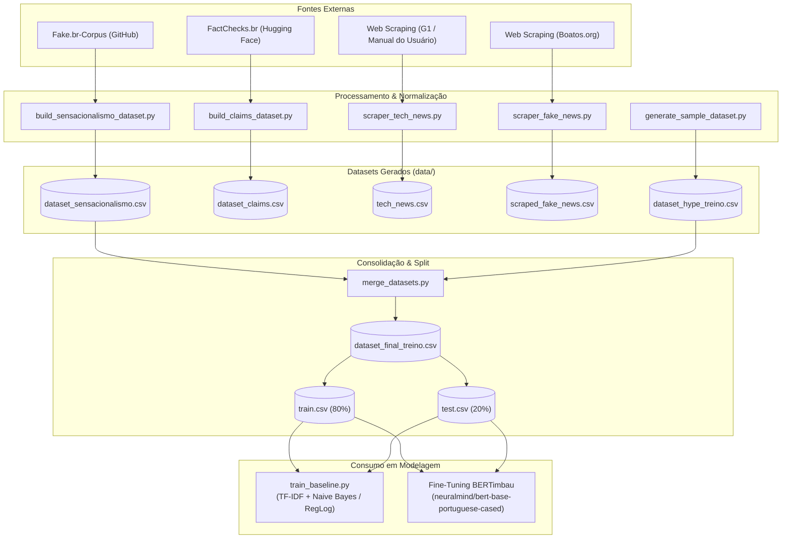
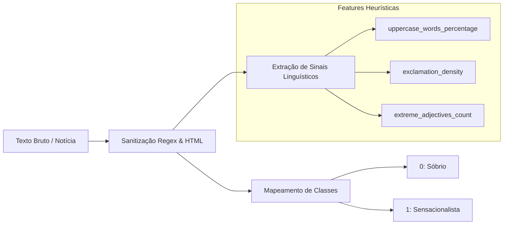

Esta página descreve o pipeline que existe hoje no diretório `src/`. Os arquivos em `data/` são gerados localmente, não fazem parte do repositório e precisam ser produzidos antes do treinamento.

## Fluxograma do Pipeline de Dados



---

## Estrutura e Transformação dos Registros



---

## Fontes e saídas atuais

| Script | Fonte | Saída | Uso atual |
| --- | --- | --- | --- |
| `build_sensacionalismo_dataset.py` | Fake.br-Corpus | `dataset_sensacionalismo.csv` | Fonte principal para o classificador binário de hype. |
| `build_claims_dataset.py` | FactChecks.br (Hugging Face) | `dataset_claims.csv` | Preparação para a tarefa futura de alegações; ainda não é consumido pela API. |
| `scraper_tech_news.py` | Manual do Usuário e G1 Tecnologia | `tech_news.csv` | Coleta de textos tecnológicos não rotulados. |
| `scraper_fake_news.py` | Boatos.org | `scraped_fake_news.csv` | Coleta de boatos e textos de desmentido; ainda não entra no merge de treino. |
| `generate_sample_dataset.py` | Exemplos sintéticos do projeto | `dataset_hype_treino.csv` | Dataset demonstrativo para validar o pipeline. |
| `merge_datasets.py` | Datasets de sensacionalismo e de amostra | `dataset_final_treino.csv`, `train.csv`, `test.csv` | Consolidação, deduplicação, balanceamento e split estratificado. |

> [!NOTE]
> O diretório `data/` está no `.gitignore`. Assim, não há dataset nem métricas reproduzíveis versionadas neste repositório.

## Pipeline de sensacionalismo

`build_sensacionalismo_dataset.py` baixa o Fake.br-Corpus, remove textos fora dos limites de tamanho e textos com alta incidência de termos político-partidários. Em seguida, equilibra as duas classes e salva texto, rótulo, target e algumas métricas linguísticas extraídas do corpus.

No estado atual, `target=1` corresponde à classe `fake` do corpus e é renomeado para `sensacionalista`; `target=0` corresponde à classe `true` e é renomeado para `sobrio`. Essa é uma aproximação para a tarefa de hype, não uma anotação humana direta de sensacionalismo. Além disso, o filtro de tecnologia é apenas preferencial: a verificação estrita está desativada no código. Esses limites devem ser considerados ao interpretar resultados.

## Alegações e risco de desinformação

`build_claims_dataset.py` baixa FactChecks.br, normaliza os rótulos para `legitimo` (0) e `desinformacao` (1), remove alegações curtas e tenta balancear as classes. Atualmente o filtro de categoria aceita todas as categorias para manter volume.

O arquivo gerado é preparatório. O endpoint da API ainda não usa um classificador treinado com essas alegações: o campo `disinformation_risk` é uma heurística derivada do score de hype e das frases encontradas.

## Scrapers

Os dois scrapers usam `requests`, BeautifulSoup, um `User-Agent` de navegador e o parâmetro `--delay` para reduzir a carga sobre os sites.

- `scraper_tech_news.py` extrai título, URL, data quando disponível e corpo de artigos do Manual do Usuário e G1.
- `scraper_fake_news.py` extrai título, URL, categoria, o texto do boato (quando presente) e os parágrafos de desmentido do Boatos.org.

Como os seletores HTML dependem dos sites externos, as coletas podem deixar de funcionar quando suas páginas forem alteradas. Os resultados também não recebem rótulo automaticamente nem são integrados ao dataset final por enquanto.

## Sequência recomendada

```bash
# Dados reais para o classificador de hype
python src/build_sensacionalismo_dataset.py

# Dados demonstrativos, se for necessário completar a segunda fonte do merge
python src/generate_sample_dataset.py

# Consolidação e splits
python src/merge_datasets.py

# Avaliação dos baselines
python src/train_baseline.py
```

Para preparar o dataset de alegações, execute separadamente:

```bash
python src/build_claims_dataset.py
```
