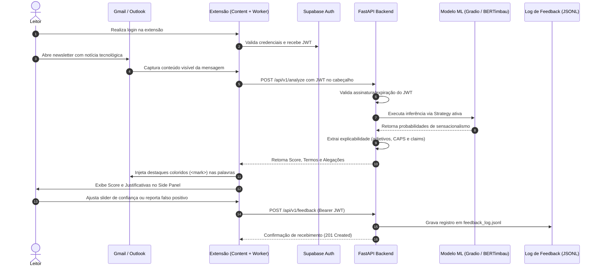

Esta seção detalha a execução integrada entre a extensão de navegador e a API FastAPI, demonstrando a extração, autenticação, classificação e envio de feedback.

---

## Diagrama da Execução Integrada Ponta a Ponta



---

## 1. Inicie a API

Certifique-se de que o arquivo `.env` do backend foi configurado com `SUPABASE_JWT_SECRET` e `MODEL_BACKEND`:

```bash
cd backend
python3 -m venv .venv
source .venv/bin/activate  # Windows: .venv\Scripts\activate
pip install -r requirements-api.txt
uvicorn app.main:app --reload --host 0.0.0.0 --port 8000
```

Confirme que o processo está ativo:

```bash
curl http://localhost:8000/health
```

Resposta esperada:
```json
{
  "status": "healthy",
  "model_loaded": true,
  "model_backend": "gradio_space"
}
```

---

## 2. Teste a Análise Diretamente (Via CLI)

Para testar as rotas protegidas por linha de comando, informe um token JWT válido gerado no Supabase (ou obtido através da extensão):

```bash
curl -X POST http://localhost:8000/api/v1/analyze \
  -H "Content-Type: application/json" \
  -H "Authorization: Bearer <SEU_TOKEN_JWT_DO_SUPABASE>" \
  -d '{
    "subject": "IA vai DESTRUIR empregos?",
    "raw_text": "URGENTE! Esta inteligência artificial revolucionária promete substituir 90% dos programadores até o fim do ano."
  }'
```

---

## 3. Compile e Carregue a Extensão

```bash
cd extension
npm install

# Para Google Chrome:
npm run build:chrome   # gera extension/dist-chrome/

# Para Mozilla Firefox:
npm run build:firefox  # gera extension/dist-firefox/
```

- **Google Chrome:** Abra `chrome://extensions`, ative o *Modo do desenvolvedor* e utilize **Carregar sem compactação** selecionando a pasta `extension/dist-chrome`.
- **Mozilla Firefox:** Abra `about:debugging#/runtime/this-firefox`, clique em **Carregar extensão temporária** e selecione `extension/dist-firefox/manifest.json`.

---

## 4. Valide o Fluxo no Webmail

1. Mantenha a API rodando em `localhost:8000`.
2. Abra a extensão no navegador e faça login (ou crie uma conta de teste no Supabase).
3. Abra uma mensagem de newsletter no Gmail ou Outlook Live.
4. A extensão analisa automaticamente o conteúdo ou permite disparar a análise manual através do botão **Analisar E-mail da Aba Aberta**.
5. Observe os termos enfáticos grifados no corpo do e-mail e o relatório detalhado no painel lateral.
6. Abra o Dashboard completo clicando no botão correspondente para visualizar métricas aprofundadas.
7. Teste o envio de feedback ajustando o slider de sensibilidade ou marcando uma alegação como falso positivo.

---

## Escopo e Funcionalidades

| Recurso | Estado Atual |
| --- | --- |
| **Extração Gmail/Outlook Live** | Implementada via seletores de DOM com sanitização de tags e propagandas. |
| **Autenticação de Usuários** | Implementada via Supabase Auth (JWT Bearer Token nas requisições). |
| **Padrão Strategy de ML** | Implementado com 4 estratégias (`gradio_space`, `bertimbau`, `sklearn` e `huggingface_api`). |
| **Grifos no Texto** | Injeção dinâmica de elementos `<mark>` no corpo do e-mail. |
| **Side Panel & Dashboard** | Desenvolvidos em React 19 com gráficos e persistência em `chrome.storage.local`. |
| **Loop de Feedback** | Registrado em arquivo estruturado `feedback_log.jsonl` no servidor. |
