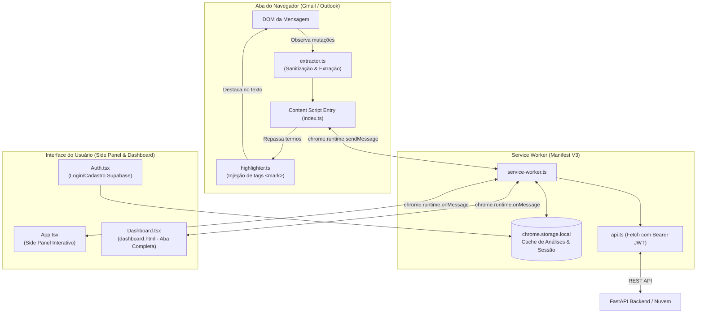
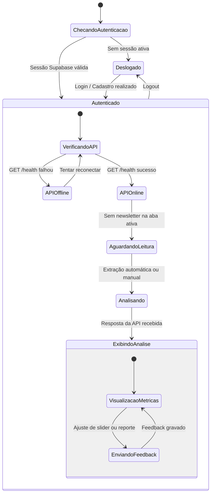

A extensão do **Inimigos do Prompt** é construída com suporte a múltiplos navegadores (Google Chrome e Mozilla Firefox) no modelo Manifest V3, utilizando React 19, TypeScript, Vite, Tailwind CSS e `@crxjs/vite-plugin`.

---

## Arquitetura Interna da Extensão



---

## Máquina de Estados do Side Panel



---

## Funcionalidades Implementadas

- **Detecção e Extração Automática:** Monitora as abas do Gmail (`mail.google.com`) e Outlook Live (`outlook.live.com`), isolando o conteúdo de newsletters e descartando rodapés, menus e rastreadores.
- **Autenticação Integrada:** Telas completas de Login e Cadastro conectadas ao Supabase, gerenciando tokens JWT com persistência segura no `chrome.storage.local`.
- **Mascote Farejador (XAI & Nudge Cognitivo):** Personificação visual que humaniza o resultado da IA através do mascote farejador com balões de diálogo reativos em linguagem natural (`Sóbrio`, `Hype Moderado` e `Hype Elevado`) e pílulas com termos críticos detectados.
- **Divulgação Progressiva (Progressive Disclosure):** Interface limpa para consumo rápido, mantendo velocímetro (1 a 5), pesos matemáticos dos termos e slider de feedback recolhidos sob demanda.
- **Destaque Visual de Tom (Highlighter):** Grifa no próprio corpo da mensagem os termos que mais contribuíram para o score de sensacionalismo.
- **Painel Lateral com Diagnóstico:** Exibe status da API, risco de desinformação, alegações suspeitas e atalho para o dashboard completo.
- **Dashboard Abrangente:** Tela em aba dedicada (`dashboard.html`) para inspecionar métricas linguísticas, contestar alegações e exportar relatórios em formato JSON.
- **Suporte Multi-Navegador:** Compilação nativa para **Chrome** (`side_panel`) e **Firefox** (`sidebar_action`).

---

## Galeria de Telas da Extensão

### 1. Mascote Farejador em Alerta de Hype Máximo
Na visão padrão, o mascote expressa o veredito crítico em linguagem natural, apontando os termos de maior peso linguístico detectados (`"revolução definitiva"`, `"100x mais rápido"`), mantendo as métricas densas recolhidas:

<p align="center">
  
</p>

### 2. Métricas Expandidas sob Demanda (Progressive Disclosure)
Ao clicar em **Exibir Métricas Numéricas e Gráficos**, a gaveta retrátil se abre exibindo o velocímetro de sensacionalismo (1.0 a 5.0), a barra de pesos de features do modelo e o slider calibrador de confiança:

<p align="center">
  
</p>

### 3. Mascote em Estado Sóbrio e Estado de Espera
Quando o texto é pé no chão e sem promessas vazias, o mascote aprova a leitura. Em abas sem newsletter ativa, ele orienta o usuário de forma amigável:

<p align="center">
  
  
</p>

---

## Estrutura Efetiva do Código

```text
extension/
├── manifest.json              # Manifesto base V3
├── index.html                 # Interface do Side Panel
├── dashboard.html             # Interface do Dashboard
├── vite.config.ts             # Script de build inteligente (Chrome/Firefox)
└── src/
    ├── App.tsx                # Componente principal do Side Panel com Progressive Disclosure
    ├── Auth.tsx               # Interface de autenticação Supabase
    ├── components/
    │   └── MascotHero.tsx     # Componente do Mascote Farejador e balão de fala dinâmico
    ├── lib/
    │   └── supabase.ts        # Cliente Supabase com storage adapter
    ├── background/
    │   └── service-worker.ts  # Worker de mensageria e orquestração
    ├── content/
    │   ├── extractor.ts       # Seletores de DOM e higienização
    │   ├── highlighter.ts     # Injetor de estilos e tags <mark>
    │   └── index.ts           # Inicializador do content script
    ├── dashboard/
    │   ├── Dashboard.tsx      # Dashboard detalhado
    │   └── main.tsx
    ├── services/
    │   └── api.ts             # Cliente HTTP com injeção de JWT
    └── types/
        └── index.ts           # Definição de tipos TypeScript
```

---

## Configuração e Compilação

Crie o arquivo `extension/.env` a partir do template:

```bash
cd extension
cp .env.example .env
```

Preencha as variáveis do Supabase e a URL da API:
```ini
VITE_SUPABASE_URL=https://SEU_PROJETO.supabase.co
VITE_SUPABASE_ANON_KEY=SUA_CHAVE_ANON
VITE_API_URL=http://localhost:8000
```

### Comandos de Build

```bash
# Instalar dependências
npm install

# Compilar para Google Chrome:
npm run build:chrome
# Gera pasta extension/dist-chrome/

# Compilar para Mozilla Firefox:
npm run build:firefox
# Gera pasta extension/dist-firefox/
```

- **Google Chrome:** Vá em `chrome://extensions`, ative o *Modo do desenvolvedor* e selecione `extension/dist-chrome` em **Carregar sem compactação**.
- **Mozilla Firefox:** Vá em `about:debugging#/runtime/this-firefox`, clique em **Carregar extensão temporária** e selecione o arquivo `extension/dist-firefox/manifest.json`.
