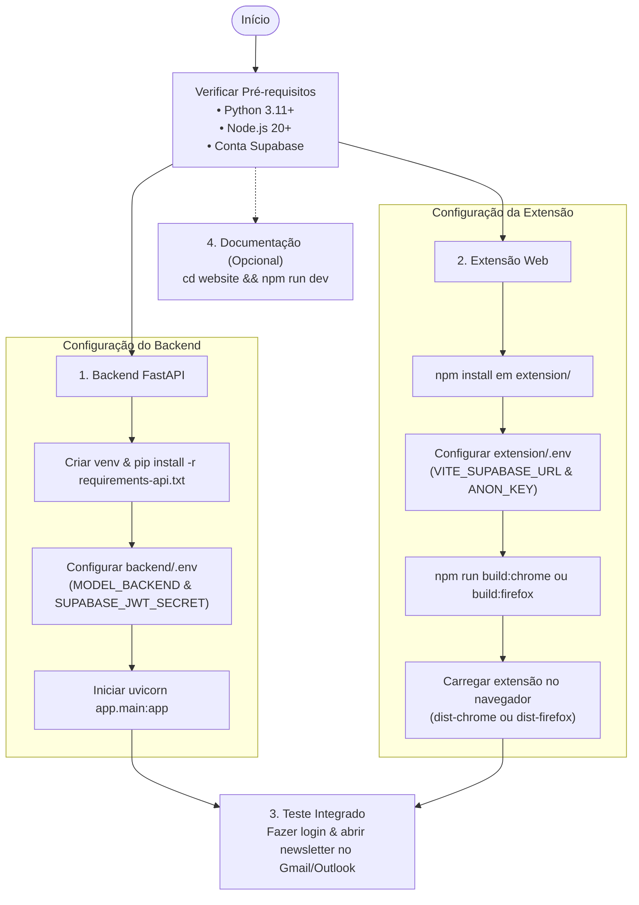

Este guia apresenta o fluxo completo para configurar os ambientes de desenvolvimento do projeto: o pipeline de ML, a API FastAPI, a extensão web e o portal de documentação.

---

## Fluxo Geral de Configuração



---

## 1. Pipeline Python e Dados (Opcional para Treinamento)

Caso deseje recriar os datasets e retreinar os baselines localmente:

```bash
# Na raiz do repositório
python3 -m venv .venv
source .venv/bin/activate  # No Windows: .venv\Scripts\activate
pip install -r requirements.txt

# Execução do pipeline
python src/build_sensacionalismo_dataset.py
python src/generate_sample_dataset.py
python src/merge_datasets.py
python src/train_baseline.py
```

---

## 2. Backend API (FastAPI)

Em um novo terminal, prepare a API:

```bash
cd backend
python3 -m venv .venv
source .venv/bin/activate  # No Windows: .venv\Scripts\activate
pip install -r requirements-api.txt
```

### Configurar Variáveis de Ambiente (`.env`)

Copie o arquivo de exemplo:

```bash
cp .env.example .env
```

Edite o arquivo `backend/.env`:
```ini
MODEL_BACKEND=gradio_space
GRADIO_SPACE_URL=https://gustant1-inimigos-prompt.hf.space
SUPABASE_JWT_SECRET=seu_jwt_secret_do_painel_supabase
```

### Iniciar o Servidor

```bash
uvicorn app.main:app --reload --host 0.0.0.0 --port 8000
```

> [!TIP]
> A API estará disponível em `http://localhost:8000`. Teste o status acessando `http://localhost:8000/health`. A documentação interativa Swagger está em `http://localhost:8000/docs`.

---

## 3. Extensão Web (Chrome / Firefox)

Em outro terminal, compile a extensão:

```bash
cd extension
npm install
cp .env.example .env
```

Preencha o `extension/.env` com as chaves públicas do seu projeto Supabase:
```ini
VITE_SUPABASE_URL=https://SEU_PROJETO.supabase.co
VITE_SUPABASE_ANON_KEY=SUA_CHAVE_ANON_AQUI
VITE_API_URL=http://localhost:8000
```

### Compilação:

```bash
# Para Google Chrome:
npm run build:chrome

# Para Mozilla Firefox:
npm run build:firefox
```

### Instalação no Navegador:

- **No Google Chrome:** Acesse `chrome://extensions/`, ative a opção **Modo do desenvolvedor** no canto superior direito, clique em **Carregar sem compactação** e selecione a pasta `extension/dist-chrome/`.
- **No Mozilla Firefox:** Acesse `about:debugging#/runtime/this-firefox`, clique em **Carregar extensão temporária...** e aponte para `extension/dist-firefox/manifest.json`.

---

## 4. Portal de Documentação (Astro Starlight)

Para rodar localmente este portal de documentação:

```bash
cd website
npm install
npm run dev
```

Acesse em `http://localhost:4321/challenge_1_inimigos_do_prompt/`.
